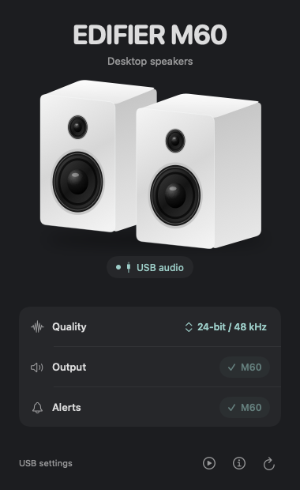

# EDIFIER USB Audio

A dependency-free, unofficial native macOS utility for **EDIFIER M60 over USB**. It shows what macOS actually reports, separates the physical USB format from CoreAudio's virtual float format, and lets you explicitly choose an advertised stereo PCM format or output route.

<p align="center">
  
</p>

**This is an app, not a driver, firmware patch, audio enhancer or EQ.** If your M60 already appears as a verified USB output, macOS is already providing the native USB audio path. A Windows-only list in a manual does not establish that a separate Mac driver is required.

## Download and install

[Download the latest release](https://github.com/rdvnit/edifier-usb-audio/releases/latest). This repository is private: only signed-in GitHub users with repository access can see or download its release assets.

**Supported device: EDIFIER M60 over USB only.** The product name does not imply support for other EDIFIER models or Bluetooth. Requires macOS 13 or later; the release app contains Apple silicon (`arm64`) and Intel (`x86_64`) slices. Intel and macOS 13 runtime compatibility have not been tested.

1. Download `EDIFIER-USB-Audio-0.1.0-universal.dmg` and `SHA256SUMS.txt` from the release.
2. From the folder containing both files, run `shasum -a 256 -c SHA256SUMS.txt` to verify the download.
3. Open the DMG and drag **EDIFIER USB Audio.app** onto its **Applications** shortcut. Do not overwrite an existing installation without reviewing it first.
4. Eject the image, connect M60 with a data-capable USB cable, select USB on the speaker, then open the app from Applications.

The app is **locally ad-hoc signed, not Developer ID signed or Apple-notarized**. Gatekeeper may block a downloaded copy. If it does, building from the reviewed source using Apple's development tools is recommended. Do not disable Gatekeeper or SIP globally. Opening or refreshing the app does not change audio settings or play sound; format, route and optional finite playback changes require explicit confirmation. Turn down the speaker's own volume before confirming the test.

## Build and run

Requires macOS 13 or later and Apple's Xcode command-line development tools (full Xcode also works). No Swift packages, downloads, Homebrew dependencies, administrator access or SIP changes.

```sh
bash scripts/test.sh
bash scripts/build.sh
open "build/EDIFIER USB Audio.app"
```

The default build targets your Mac's architecture. `bash scripts/build.sh --universal` builds both Apple silicon and Intel. The minimum deployment target is macOS 13; actual verification was performed on an Apple-silicon Mac with a newer system SDK. Compatibility on macOS 13 and Intel hardware has not been runtime-tested.

The generated app is **ad-hoc signed locally**, not Developer ID signed or notarized. Do not present the ZIP as a notarized release. For public binary distribution, obtain a Developer ID signature and Apple notarization or have recipients build from source. Do not disable Gatekeeper system-wide.

## Use

1. Connect a **data-capable USB cable** and select **USB input on the speaker**.
2. The app requires the known USB VID `2d99`, PID `a094`, exact product, and a unique manufacturer/product/serial match between the live IORegistry device and Apple's CoreAudio USB UID. Bluetooth, friendly-name-only matches and ambiguous devices are rejected. The tested UID shape is `AppleUSBAudioEngine:<manufacturer>:EDIFIER M60:<serial>:<engine>`; other driver/firmware UID shapes deliberately remain unsupported pending evidence.
3. In the compact dark panel, open the **Quality** menu to see advertised physical USB formats. Choose a different format and confirm the change. The main readout always shows the current physical format, not an unconfirmed choice. Duplicate mixable/non-mixable variants are merged, preferring mixable PCM.
4. The **Output** and **Alerts** buttons select M60 for their named route after confirmation. A checked M60 pill means it is already selected; it is not a speaker power switch. Apps with their own audio settings may override the system default.
5. The **USB audio** pill describes the verified USB connection. This utility cannot read the speaker's actual selected input mode or power/EQ state.
6. The **ⓘ** icon opens physical/virtual format comparison, raw evidence, full errors and local diagnostics. The large white M60 artwork is an original illustration, not a detected cabinet color.
7. Optionally click the **play-circle** icon and confirm after turning down the M60's own volume. This finite left-then-right test is bound to the exact verified device, not the current default. It uses 440 Hz with fades and a maximum digital amplitude of `0.02`; even that can be loud at a high speaker gain.

All hardware changes require explicit confirmation. Opening the app, refreshing, copying diagnostics and running the CLI do not write audio properties or play sound. The app polls read-only properties every three seconds while open, including connection, format and route changes. It installs no daemon or login item and never changes settings automatically. Formats are disabled for ambiguous/multi-stream devices. Every write revalidates the device identity and reads back the exact property; errors explain when a write may have partially succeeded. The utility does not attempt hidden rollback.

## Which format?

The initial tested device reported **16-bit stereo / 48,000 Hz physically**, **32-bit float stereo / 48,000 Hz virtually**, and advertised physical 16/24-bit stereo at **48,000 and 96,000 Hz**. Those are a measured snapshot, not values hard-coded as universal capabilities.

For mixed music, videos and calls, **24-bit / 48 kHz is a practical choice when advertised**, especially when software changes volume or mixes streams. It cannot recover missing detail from a 16-bit source. **96 kHz is useful for matching a high-rate source, not an automatic quality upgrade.** If source and output sample rates differ, the player or CoreAudio may resample. This M60 snapshot did not advertise 44.1 kHz; forcing it is not supported.

These readouts **do not prove bit-perfect playback, acoustic quality or the internal speaker DSP/DAC rate**. A reported 16-bit format does not by itself establish audibly degraded or broken Mac support. Streaming-service quality, application routing, software volume, source format, speaker volume/EQ and room acoustics also matter.

USB/AUX volume synchronization is not supported according to the M60 manual: **Mac playback gain and speaker touch volume are separate levels**. This does not mean that Mac volume is unsupported: the tested M60 exposes writable CoreAudio master output volume/mute and virtual main volume. Mac volume should affect USB playback loudness when audio uses that route; it does not synchronize the speaker's own touch-volume setting. The app does not change mute/volume or promise an acoustically verified volume mapping.

Speaker EQ, input switching and firmware are outside this utility. The official EDIFIER ConneX iOS app may be offered on Apple-silicon Macs; its Mac M60 BLE-control behavior has not been verified here. This project does not implement or claim vendor control support.

## Read-only CLI

```sh
build/edifier-usb-audio --diagnose
# The app executable supports the identical non-GUI path:
"build/EDIFIER USB Audio.app/Contents/MacOS/EDIFIER USB Audio" --diagnose
```

JSON schema version 1 reports the verified USB fingerprint, output devices, transport/alive/running state, current routes, nominal rate/ranges, stream physical/virtual ASBDs, available physical format/rate ranges and individual read errors. Keys, device/stream order and format order are stable. This is a current hardware snapshot, not a persistent device database. No timestamp is embedded.

Exit codes: `0` live verified M60; `2` no live verified M60 (with cable/input guidance on stderr); `1` top-level diagnostic or JSON failure; `64` invalid arguments. A connected snapshot may still contain individual property read errors; inspect the `errors` arrays before interpreting missing fields. Standard output is JSON only for `--diagnose`.

**Privacy:** diagnostics include output-device names, UIDs, and the M60 USB serial/location/registry identifiers. Copy is local clipboard only; nothing is transmitted. Review or redact diagnostics before posting publicly. Local verification JSON/logs are gitignored and excluded from archives.

## DMG packaging

```sh
bash scripts/package-dmg.sh
```

This always rebuilds the universal app with warnings treated as errors, validates version `0.1.0` / build `1`, bundle ID `io.github.rdvnit.EDIFIERUSBAudio`, macOS 13 minimum, both executable slices and the ad-hoc signature. It stages only the app, a standard `/Applications` symlink, `INSTALL.txt` and the complete MIT `LICENSE` notice, compares every staged bundle file hash and permission with the build, then uses Apple's `hdiutil` to produce and verify a compressed UDZO image:

- `build/EDIFIER-USB-Audio-0.1.0-universal.dmg`
- `build/SHA256SUMS.txt`, SHA-256 of the DMG computed with Python's standard library.

No source, standalone CLI or local verification data is included in the DMG. The script needs only Apple's existing build/image tools and Python 3; it does not download dependencies or sign with external credentials. After `hdiutil verify`, it mounts the image read-only, compares the app's complete hashes, permissions and metadata with the build, checks the install text, complete source-identical license notice and shortcut, verifies the mounted signature and detaches it before emitting the checksum. Temporary staging is removed after packaging. The workflow is reproducible as a documented rebuild process, not a claim that independently created disk images are byte-identical.

## Tests, architecture and sharing

`bash scripts/test.sh` runs pure Swift discovery/identity, format validation, stable-ID/rate matching, duplicate-selection, mutation-guard, bounded asynchronous-readback tests and waveform bounds/fades/channel separation. It also compiles the real AppModel against injected read/action functions to test confirmation during refresh and error publication. Tests do **not** mutate hardware or play audio.

- `Sources/Models.swift`: strict identity and format policy, Codable snapshots.
- `Sources/AudioHardware.swift`: strictly read-only HAL/IORegistry snapshot.
- `Sources/AudioActions.swift`: UI-only identity-guarded, explicit write/readback functions; not linked into the standalone CLI.
- `Sources/QuietTone*.swift`: pure bounded signal and explicit device-bound AudioUnit test.
- `Sources/AppModel.swift` / `ContentView.swift`: background serial hardware work, polling and native SwiftUI UI.
- `Sources/DiagnosticCommand.swift`: shared strictly read-only CLI path.
- `scripts/build.sh`: SDK-only `.app` and CLI build, generated original icon, ad-hoc signature.

```sh
bash scripts/archive.sh
```

Creates the optional `build/EDIFIER-USB-Audio-local.zip` with source, tests, docs, scripts, app and CLI. Local verification snapshots and screenshots are excluded. The downloadable release uses the DMG and checksum instead of this source archive.

See [verification and manual acceptance](docs/VERIFICATION.md). MIT licensed. Unofficial community software, not affiliated with, endorsed by or supported by EDIFIER. EDIFIER and M60 are their owners' trademarks.

### Reference sources

- [Official M60 manual, sections 7–8](https://new-edifier-us-oss.edifier.com/files/20240914/b229ad7e7c35660c4a9c14dda2f8c27a.pdf)
- [Official EDIFIER ConneX Apple App Store listing](https://apps.apple.com/us/app/edifier-connex/id6469028132)
- [Apple CoreAudio documentation](https://developer.apple.com/documentation/coreaudio)
- [Apple Audio MIDI Setup format controls](https://support.apple.com/guide/audio-midi-setup/set-up-audio-devices-ams59f301fda/mac)
